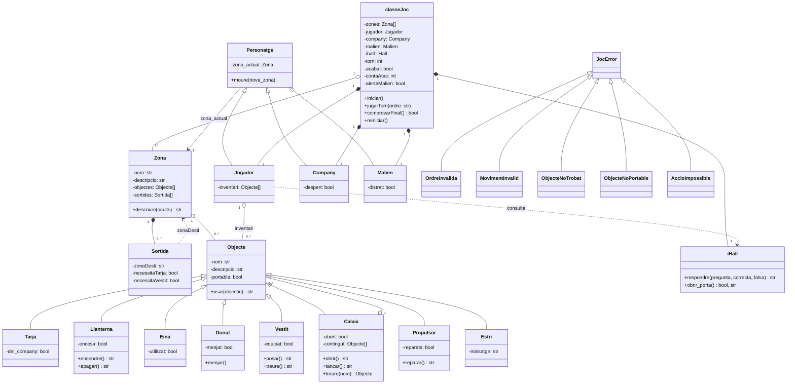

# Diagrama de classes

Estat final de la implementació (la versió lliurada el 20 de setembre és `Diagrama de classes.drawio.pdf`, a l'arrel del repositori).

## Ordres

Cada ordre és una funció a `src/ordres/`. `interpret.py` separa el verb de l'objectiu i `despatx.py` crida la funció de l'objecte (`agafar`, `deixar`, `encendre`, `apagar`, `obrir`, `tancar`). `anar` i `usar` necessiten l'estat de la partida i els crida directament `classeJoc`; `parlar` viu a `classeJoc` perquè depèn de l'estat del joc (iHall, company).
